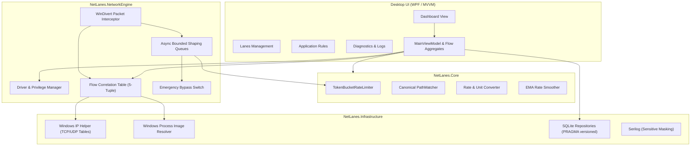

# NetLanes System Architecture & Engineering Design

## 1. High-Level Architecture Overview

NetLanes is built as a modular Windows desktop system comprising four core layers:
1. **Presentation (WPF MVVM)**: Responsive desktop interface presenting live metrics, lane management, rule configuration, and diagnostics.
2. **Application & Domain Core (`NetLanes.Core`)**: Business logic, rate-limiting algorithms, domain entities, rate calculators, and unit converters.
3. **Infrastructure & Platform (`NetLanes.Infrastructure`)**: Windows IP Helper API integration, SQLite persistence, process identity resolution, and Serilog logging.
4. **Network Engine (`NetLanes.NetworkEngine`)**: Low-level packet capture, 5-tuple flow tracking, token-bucket pacing queues, driver lifecycle management, and emergency fail-safe switching.



---

## 2. Solution Layout & Project Responsibilities

```text
NetLanes.sln
├── src/
│   ├── NetLanes.Core/                  # Pure domain, interfaces, and rate-limiting algorithms
│   │   ├── Models/                     # Lane, ApplicationRule, ApplicationIdentity, NetworkFlow
│   │   ├── Interfaces/                 # Repository and service contracts
│   │   ├── RateLimiting/               # High-precision TokenBucketRateLimiter, TimeProvider
│   │   └── Utilities/                  # Canonical PathMatcher, UnitConverter, EMASmoother
│   │
│   ├── NetLanes.Infrastructure/        # Platform-specific OS and I/O implementations
│   │   ├── Persistence/                # SQLite migrations, LaneRepository, RuleRepository
│   │   ├── Windows/                    # IpHlpApi P/Invoke (TCP/UDP tables), QueryFullProcessImageName
│   │   └── Logging/                    # Serilog file sink configuration with sensitive data filters
│   │
│   ├── NetLanes.NetworkEngine/         # WinDivert integration and packet manipulation
│   │   ├── DriverManagement/           # Administrator check, WinDivert driver installation status
│   │   ├── Interop/                    # WinDivert C# P/Invoke structs and entry points
│   │   ├── FlowTracking/               # 5-tuple to PID/Exe correlation, reverse flow normalizer
│   │   └── TrafficShaping/             # Bounded queues, pacing engine, safe overflow handler
│   │
│   └── NetLanes.App/                   # WPF UI (MVVM)
│       ├── Views/                      # Dashboard, Lanes, Rules, Diagnostics, Settings, About
│       ├── ViewModels/                 # MainViewModel, LanesViewModel, RulesViewModel, etc.
│       ├── Resources/                  # Dark theme brushes, controls, styles, and vector icons
│       └── App.xaml / Program.cs       # Generic Host bootstrapping, DI registration
│
├── tests/
│   ├── NetLanes.Core.Tests/            # Unit tests for algorithms, path matching, conversions, persistence
│   └── NetLanes.Networking.Tests/      # Integration tests with controlled sockets and flow tracking
│
└── docs/                               # Comprehensive engineering specifications
```

---

## 3. Flow Tracking and Process Correlation

WinDivert intercepts network packets at `WINDIVERT_LAYER_NETWORK`. Packets at this layer contain raw IP/TCP/UDP headers but do **not** carry process IDs. To bridge this gap with 100% accuracy, NetLanes employs a two-tiered correlation mechanism:

1. **5-Tuple Extraction**:
   - Extract `(Protocol, LocalIP, LocalPort, RemoteIP, RemotePort)` from the IPv4/IPv6 and TCP/UDP headers.
   - For inbound packets, normalize the tuple by reversing local and remote endpoints to match the host socket binding.
2. **Flow Correlation Table**:
   - Maintains an in-memory, thread-safe cache (`ConcurrentDictionary<FiveTuple, FlowOwnerInfo>`).
   - Sourced from Windows IP Helper tables (`GetExtendedTcpTable` and `GetExtendedUdpTable` with `TCP_TABLE_OWNER_PID_ALL` and `UDP_TABLE_OWNER_PID`).
   - Polled rapidly on cache misses and periodically refreshed (every 1000ms) to detect connection churn and new flows.
3. **Executable Image Resolution**:
   - Once a PID is obtained from IP Helper, `OpenProcess` with `PROCESS_QUERY_LIMITED_INFORMATION` followed by `QueryFullProcessImageNameW` extracts the canonical disk path (e.g., `C:\Program Files\Steam\steam.exe`).
   - Results are cached by `(PID, ProcessStartTime)` to guard against PID reuse.
   - If an application exits or a PID is recycled, the entry is invalidated.

---

## 4. Packet Interception and Traffic-Shaping Pipeline

```text
[Incoming/Outgoing Packet]
         │
         ▼
[WinDivertRecvEx]
         │
         ▼
[Is Emergency Stop OR Safe Overflow?] ──► YES ──► [WinDivertSend (Immediate Pass)]
         │ NO
         ▼
[Extract 5-Tuple & Direction]
         │
         ▼
[Lookup Flow in Flow Correlation Table]
         │
         ├───► Unknown/Unmatched Flow ──► [WinDivertSend (Pass Unaltered)]
         │
         ▼
[Lookup Application Rule & Lane Limit]
         │
         ├───► Rule is Unlimited ────────► [WinDivertSend (Pass Unaltered)]
         │
         ▼
[Enforce Token Bucket Capacity]
         │
         ├───► Tokens Available?
         │         ├──► YES: Consume tokens & [WinDivertSend]
         │         └──► NO:  Enqueue into Per-App Bounded Queue
         │
         ▼
[Pacing Loop (Task/PeriodicTimer)]
         │
         ▼
[When Tokens Refilled]: Dequeue packet & [WinDivertSend]
```

### Reinjection Loop Prevention
WinDivert handles can intercept packets reinjected by other handles or the same process. NetLanes prevents reinjection loops by:
- Setting the filter to exclude loopback packets unless specifically testing local flows.
- Utilizing handle priorities: NetLanes opens packet injection with higher priority or utilizes the `WINDIVERT_FLAG_NO_CHECKSUM` / packet reinjection attribute so that reinjected packets bypass further processing.
- Applying an internal outbound tracking tag to prevent self-interception.

### Bounded Queues and Safe Overflow
If network throughput exceeds the configured rate limit over a sustained duration, packets accumulate in memory. An unbounded queue risks running out of RAM or causing severe latency (bufferbloat).
- **Hard Queue Ceiling**: Default limit of 2,000 packets or 4 MiB per application.
- **Safe Overflow Strategy**: When the queue limit is reached, NetLanes logs a diagnostic warning and immediately passes newly arrived packets through without shaping (`Safe Overflow Pass-Through`), rather than dropping user traffic indiscriminately.

---

## 5. Security & Elevation Model

1. **Elevation Requirement**:
   - WinDivert's kernel driver requires administrator privileges (`SE_DEBUG_NAME` / administrative token) to install and open driver handles.
   - If NetLanes is launched as a standard user, it defaults to **Passive Monitor Mode**.
   - The UI displays an elevated shield icon allowing the user to restart NetLanes with elevated credentials via UAC (`Verb = "runas"`).
2. **Payload Protection**:
   - NetLanes strictly inspects packet headers (L3 IP and L4 TCP/UDP).
   - Packet payload bytes are **never** logged, stored, or inspected.
   - Diagnostic logs exclude URLs, hostnames, and credentials.
